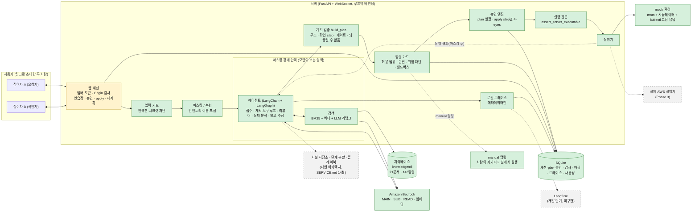

# DevOps Plan/Apply Agent

AWS 인프라 운영의 반복 작업(작업 계획 생성, CLI 명령 작성)을 모델이 대신 만들고, **두 사람이 같은 화면에서 확인·승인한 뒤 실행**하는 웹 도구입니다.

> **현재 상태: 개발 중 (Phase 1, 로컬 + mock 실행).** 지식베이스, 검색기, 가드레일, 에이전트, 실행기, 세션·승인 흐름, 웹 서버(WebSocket API)와 웹 화면(좌측 이력·새 작업·작업자, 중앙 절차 목록, 우측 대화)까지 동작합니다. 무엇이 되고 무엇이 아직인지는 [구조도](#구조도)와 [현재 상태](#현재-상태)를 보세요.

## 무엇을 푸나

작업 계획과 CLI 명령을 일일이 쓰는 데 시간이 들고 사람이 실수하기 쉬운 AWS 운영 작업을, 모델이 문서 근거로 만들게 하고 **사람 둘이 확인·승인한 뒤에만** 실행되게 합니다.

1. 사용자가 자연어로 요청합니다. 예: "시큐리티그룹 443 열어줘", "EKS를 1.36으로 올릴 계획 세워줘"
2. 민감값(계정 ID, ARN, 리소스 ID, 리소스 이름 등)을 플레이스홀더로 바꿔 모델에 전달합니다. 모델은 실제 값을 보지 않습니다.
3. 모델이 **내부에 저장된 AWS CLI·kubectl 문서를 검색**해, 그 근거로 단계별 작업 계획과 명령을 만듭니다. 화면에 근거 문서를 함께 보여줍니다.
4. 링크로 초대한 두 사람이 계획을 같이 보고, **요청자가 아닌 사람이 승인**하면 서버가 실행합니다. 결과도 같이 봅니다.

## 핵심 특징

- **문서 근거 명령 생성:** 143개 명령을 직접 작성한 문서로 보관하고 실제 `aws`/`kubectl` 도움말과 대조해 검증합니다. 문서에 없는 명령은 "AI 추정"으로 표시하고 더 엄격하게 승인합니다.
- **4-eyes 승인:** 변경 명령은 요청자와 다른 사람이 승인합니다. plan은 일괄 승인, apply는 step마다 승인합니다.
- **영향 사전 확인:** 변경마다 서비스 중단 가능성, 되돌림 가능 여부, 사전 점검 명령을 문서에 적어 두고 승인 화면에 보여줍니다.
- **대규모 작업:** EKS 업그레이드 같은 긴 작업을 단계(phase)와 게이트로 나누고, 중간에 실패하면 남은 step만 고쳐 다시 승인받습니다.
- **수동 실행 명령:** `kubectl exec`처럼 서버가 실행하면 안 되는 명령은 문구만 제공하고 사람이 자기 터미널에서 실행합니다.
- **가드레일:** 입출력 필터, 마스킹, 에이전트 도구는 읽기 전용, 가드 오류 시 차단(fail-closed).

## 구조도

초록 실선은 구현·테스트가 끝난 것, 노랑은 일부만 구현한 것, 회색 점선은 아직 만들지 않은 것입니다(2026-11-06 기준). 구성요소별 책임과 신뢰 경계는 [SERVICE.md 12절](SERVICE.md#12-현재-아키텍처-phase-1), 문제점은 13절, 개선 방향과 대안 아키텍처는 14절에 있습니다.



- **마스킹 경계:** 모델·임베딩·리랭크·트레이스는 마스킹된 텍스트만 봅니다. 실제 값은 승인 화면과 실행 단계에서만 서버가 복원합니다.
- **모든 명령은 같은 길을 지납니다:** 계획 검증 → 명령 가드 → 승인 엔진 → 실행 관문. `manual` 명령은 이 관문에서 막혀 사람이 직접 실행합니다.
- **에이전트는 제안만 합니다:** 도구는 읽기 전용(문서 검색, 인벤토리 조회, 읽기 명령 실행)이고, 변경은 승인 엔진을 거쳐야 합니다.
- **지식베이스와 색인:** 앱이 읽는 원본은 `knowledge/cli`, 검색 색인은 실행하면 만들어지는 `data/chroma`입니다.
- SQLite에는 감사 기록(가드 판정), 세션·참여자·plan 버전·step 상태·승인·실행 결과·이벤트, 암호화된 마스킹 매핑, 로컬 트레이스(메타데이터만), 모델 사용량이 저장됩니다. 서버를 재시작해도 승인된 plan을 이어서 실행할 수 있습니다.
- 웹은 화면 일부(종료된 작업의 파일 내용 표시 등)가 아직 없어 노랑으로 표시했습니다.

## 현재 한계와 개선 과제

자세한 근거(측정 값 포함)는 [SERVICE.md 맨 위 표와 13~14절](SERVICE.md)에 있습니다.

- **큰 계획(EKS 업그레이드)이 무겁고 불안정합니다:** 한 건에 도구 호출 22~30회·약 26~50만 토큰이고 호출 상한(30회)에 걸려 같은 케이스가 2회 중 1회만 끝까지 갔습니다. 요청을 사전/사후로 나눠도 총 사용량은 약 2.5배라 줄지 않았습니다.
- **중단하면 이어서 할 수 없습니다:** 생성이 한도로 멈추면 "다시 시도"는 처음부터이고, 중단(aborted)된 작업도 되돌릴 수 없습니다.
- **같은 뜻의 요청이 표현에 따라 다르게 나올 수 있고**, 문서에 없는 명령은 AI 추정으로 갑니다. 되돌릴 수 없는 `iac` 단계의 표시는 일부만 서버가 검증합니다.
- **실제 AWS에서는 검증하지 않았고**(mock만), 인증은 닉네임 자기 신고입니다. 평가는 42건·1회·규칙 채점 중심입니다.
- **대안 아키텍처:** 결정적 사전 조사 + 사실 저장소 + 단계 분할, 검토된 플레이북, 중단 후 재개를 검토했고(구현 안 함) SERVICE.md 14절과 D-65에 비교표와 측정 순서를 남겼습니다.

## 활용한 패턴 (Day 1~7)

| 패턴 | Day | 이 프로젝트에서 | 상태 |
|---|---|---|---|
| LCEL chain · Pydantic 구조화 출력 | 1 | 접수(질의 정규화·범위 판단), 계획, 리뷰어, 실패 분석의 출력을 스키마로 검증하고 실패 시 재시도 후 사람에게 넘김(`validate_structured`) | 사용 중 |
| RAG (하이브리드·리랭킹) | 2 | 명령 단위 chunk, BM25(한국어+CLI 토큰) + Titan 벡터 + RRF + LLM 리랭크 | 사용 중 |
| ReAct (도구 자율 선택) | 3 | 계획·실패 분석 에이전트가 읽기 전용 도구를 자율 호출(조사 → 제출 → 서버 검증 → 수정) | 사용 중 |
| 도구 다중 | 4 | 문서 검색·인벤토리 조회·읽기 명령 3종을 한 요청에서 결합 (DB·계산기·외부 API는 범위 밖) | 사용 중 |
| MCP 서버 연동 | 4 | 사용하지 않음 | 범위 밖 |
| 가드레일 (인젝션·PII) | 5 | 입력·명령 가드, 마스킹, 간접 인젝션 방어, 시크릿 차단, 에이전트 한도, 실행 관문 | 사용 중 |
| HITL (위험 작업 승인) | 5 | 4-eyes 승인(plan 일괄·step별), 위험 phase 게이트(되돌릴 수 없는 단계는 사유를 적어야 해제), 일시정지·부분 재계획·재개, 반려. 엔진·WebSocket API·화면 구현 | 사용 중 |
| 미들웨어 (요약·마스킹·재시도) | 5 | 마스킹, 스키마 재시도, MAIN 쓰로틀링 시 SUB 폴백, 단계가 끝나면 중간 대화를 요약으로 압축 | 사용 중 |
| Multi-Agent Supervisor | 6 | 서비스별 전문 에이전트 + supervisor | Phase 2 후보 |
| Plan-Execute · 장기 메모리 | 7 | plan 생성(phase·게이트·롤백·확인 step), 승인·apply 흐름, mock 실행기는 구현. 이력 기반 재사용(장기 메모리)은 Phase 2 | 일부 |
| Observability · Trace | 7 | 로컬 트레이스(`data/trace.sqlite`, 메타데이터만) 구현, Langfuse는 개발 단계 한정 계획이며 미구현 | 일부 |
| 평가 (RAGAS · LLM-as-Judge) | 7 | 검색 평가셋·에이전트 평가셋(규칙 채점)은 측정함. LLM-as-Judge는 구현했으나 미측정, RAGAS는 미실행 | 일부 |

## 현재 상태

| 영역 | 상태 |
|---|---|
| CLI 지식베이스 (`knowledge/cli`, 문서 21개·명령 143개) + 용어 사전 + 검증기 | 완료 |
| 검색기 (BM25 + 벡터 + LLM 리랭크, 평가셋 80 케이스(2026-11-04 측정)에서 hit@1 0.99, 현재 평가셋은 88건) | 완료 |
| 가드레일 (마스킹·복원, 입력·명령 가드, 에이전트 한도, 실행 관문, 감사 기록) | 완료 (코드·테스트). 에이전트·승인 흐름·웹에 연결됨 |
| 에이전트 (접수, 계획, 리뷰어, 실패 분석) | 완료 (코드·테스트). 전환(D-55) 뒤 실제 모델로 에이전트 평가셋 42건과 EKS 업그레이드를 여러 번 측정(아래 평가 절). 큰 계획은 호출·토큰이 크고 불안정(SERVICE.md 13절). 승인 흐름·웹에 연결됨 |
| 프롬프트 캐싱(D-56) | 계획·실패 분석 도구 루프에 적용. 측정(2026-11-05, `eval/measure_tokens.py`, 요청 1건·설정별 1회, 각 13호출): 캐시 끔 입력 174,285 토큰 → 캐시 켬 174,502 중 84%가 캐시 읽기, 입력 환산(어림) 약 29%. 속도 차이는 작고(72초→65초) 일일 토큰 한도·쓰로틀링 완화 효과는 확인하지 못함 |
| 실행기 (단일 관문, 요청별 격리 환경, 루프백 moto + 시뮬레이터 + kubectl 고정 응답) | 완료 (코드·테스트) |
| 세션·승인·apply 진행 (멤버 토큰 신원, plan 해시 잠금, step·게이트 4-eyes, 실패 후 재시도·건너뛰기·중단, manual·iac·poll, 재시작 복구, 부분 재계획) | 완료 (코드·테스트, 실제 모델·mock 실행기로 EKS 세션 확인) |
| 웹 서버 (FastAPI + WebSocket, 인증·Origin 검사) | 완료 (코드·테스트) |
| 웹 UI (단일 HTML, 세로 3분할: 이력·작업자 / Plan 연습장·Apply 실행 / 대화) | 대부분 완료 (가짜 DOM 테스트 + 실제 Chrome 조작 확인). Plan 탭은 연습장(초안·확정·Apply로 보내기, 빈 plan, 직접 입력, 말로 수정), 종료된 작업은 결과 요약을 상단에 표시. 게이트 해제(사유 입력) 화면은 브라우저에서 확인하지 못했고, 파일 내용 표시(`show_file_contents`)는 미구현 |
| 앞 절차 결과 참조(`@{절차.필드}`, D-48) | 코드·테스트 완료, mock(moto) 종단 확인(SG 생성 → 그 ID로 규칙 추가). 실제 모델이 참조를 쓰는 것을 1회 관찰(2026-11-06, 보안 그룹 생성 요청의 확인 절차), 체계적 측정은 미실시 |
| 연습장 + 말로 수정 | 코드·테스트 완료. 실제 모델로 초안을 만드는 경로는 에이전트 평가셋 실행으로 측정했고(평가 절), 말로 수정(수정안 제안)을 실제 모델로 측정한 것은 미실시 |
| 관측 (로컬 트레이스) | 구현·테스트 완료(D-60): 모델 호출·도구 호출·계획 결과를 메타데이터만 SQLite에 기록하고 `eval/trace_summary.py`로 요약. Langfuse는 미구현 |
| 에이전트 평가 | 평가셋 42건을 규칙 채점으로 측정(첫 측정 90.0%, guardrail 100%). Judge 채점과 사람 일치도는 미측정 |

에이전트(접수·계획·리뷰어·실패 분석·말로 수정)는 LangChain(`ChatBedrockConverse`)과 LangGraph(`StateGraph`)로 구현했습니다(D-55). 계획·실패 분석의 도구 루프, 접수→계획→리뷰 파이프라인, 접수·리뷰어·말로 수정의 "호출 → 스키마 검증 → 재시도" 흐름이 LangGraph 그래프이고, 검색의 임베딩(`BedrockEmbeddings`)과 리랭크도 `langchain-aws`입니다. 계획·실패 분석의 도구 루프에는 프롬프트 캐싱을 씁니다(D-56). `langgraph-supervisor`와 MCP 패키지는 설치만 되어 있고 앱이 import하지 않습니다. 모델 제공자는 Bedrock입니다.

세부 작업은 [TASK.md](TASK.md)에서 추적합니다.

## 실행 방법

개발은 Windows(PowerShell) 기준으로 진행하고 있습니다.

### 필요한 것
- Python 3.14
- AWS CLI v2, kubectl (문서 검증기가 실제 도움말과 대조하는 데 씁니다)
- Bedrock 호출이 가능한 AWS 자격증명 (LLM·임베딩용. 아래 `.env`)

### Docker로 실행 (권장, 검증 환경을 모를 때)
이미지 안에 Python 3.14, AWS CLI v2, kubectl, 앱 패키지가 모두 들어 있어 Docker만 있으면 됩니다(WSL2의 Docker로 빌드·실행을 확인했습니다, 2026-11-06: 이미지 1.94GB·빌드 약 3분, 가드 스냅샷이 문서 명령 143개와 일치, 컨테이너가 비root로 8000 포트에서 `/api/health` 200, 세션 생성·검색·가드 검증 확인).
```
docker build -t devops-agent .
docker run --rm -p 127.0.0.1:8000:8000 --env-file .env -v devops-agent-data:/data devops-agent
```
- 브라우저에서 `http://localhost:8000`(직접 실행과 같은 포트입니다. 둘을 동시에 띄우면 겹치므로 하나만 실행하세요). **호스트 쪽 포트는 반드시 `127.0.0.1`로만 여세요**(인증이 닉네임·멤버 토큰뿐입니다).
- `.env`(Bedrock 키와 `MAIN_MODEL`·`SUB_MODEL`·`READ_MODEL`, `.env.example` 참고)는 이미지에 들어가지 않고 `--env-file`로만 전달됩니다.
- 첫 실행은 문서 색인(Titan 임베딩, Bedrock 필요)과 DB·키를 만드느라 1분쯤 걸립니다. `data/`는 지워도 다시 만들어지고(제출 시 제외), 가드 스냅샷은 이미지에 미리 들어 있습니다.
- 이미지는 약 1.9GB이고 첫 빌드는 3분쯤 걸립니다(kubectl은 빌드 시점 최신 stable, 고정하려면 `--build-arg KUBECTL_VERSION=v1.xx.y`).

### 설치(직접 실행)
```powershell
python -m venv .venv
.venv\Scripts\python.exe -m pip install -r requirements.txt
copy .env.example .env      # 열어서 값을 채운다
```
`.env`에는 Bedrock용 키와 모델 ID가 들어갑니다. **`.env`는 git에 올리지 않습니다**(`.gitignore`에 있음). 이 키는 실행기(mock)에 전달되지 않습니다.

### 지금 실행할 수 있는 것
```powershell
# 문서 검증: 명령·옵션이 실제 aws/kubectl에 있는지, impact 필드 등을 확인
.venv\Scripts\python.exe tests\check_docs.py

# 테스트 (오프라인). 처음 실행하면 aws/kubectl 도움말로 옵션 스냅샷(data/cli_snapshot.json)을 만드느라 약 40초 걸린다
.venv\Scripts\python.exe -m pytest tests -q
# Bedrock을 호출하는 검색 테스트와, 실제 aws/kubectl 도움말로 문서 옵션을 전부 대조하는 테스트까지
$env:RUN_BEDROCK_TESTS="1"; $env:RUN_CLI_TESTS="1"; .venv\Scripts\python.exe -m pytest tests -q

# 검색 방식 비교 평가 (Bedrock 호출, 결과는 eval/reports/에 저장)
.venv\Scripts\python.exe eval\eval_retrieval.py --rerank --show-failures 10

# mock 실행기(moto 서버 + 시뮬레이터 + kubectl 고정 응답) 테스트. aws CLI가 필요하고 moto 서버를 자동으로 띄운다(약 30초)
.venv\Scripts\python.exe -m pytest tests\test_mock_executor.py -q

# EKS 1.35→1.36 업그레이드 시나리오를 실제 모델(Bedrock)과 mock 실행기로 한 번 끝까지(접수 → 계획 → 리뷰어). 2~3분, 모델 호출 비용(약 30만 토큰)이 든다
.venv\Scripts\python.exe eval\run_eks_scenario.py
```

### mock AWS 서버로 CLI 시험해 보기
실행기가 쓸 moto 서버를 직접 띄워 볼 수 있습니다. 실제 AWS로 나가지 않도록 더미 키와 엔드포인트를 지정합니다.
```powershell
$env:AWS_ACCESS_KEY_ID="testing"; $env:AWS_SECRET_ACCESS_KEY="testing"; $env:AWS_DEFAULT_REGION="us-east-1"
.venv\Scripts\python.exe -m moto.server -p 5000        # 다른 터미널에서 실행해 둔다
aws --endpoint-url http://127.0.0.1:5000 ec2 describe-security-groups
```

### 웹 서버 실행
```powershell
.venv\Scripts\python.exe -m app.web.main            # 127.0.0.1:8000, 실제 Bedrock 모델 + mock 실행기
```
`GET /api/health`가 `{"ok":true}`를 돌려주고 `GET /`가 화면을 내려주는 것까지 확인했습니다(2026-11-05). 브라우저에서 `http://127.0.0.1:8000`을 열고 `＋ 새 작업`을 눌러 제목과 닉네임을 정한 뒤 오른쪽 대화창에 작업을 입력합니다. 추가 정보가 필요하면 같은 대화에서 물어보고, 답을 입력하면 이어서 계획을 만듭니다. 가운데에서 절차를 검토·수정(끌어서 순서 변경)하고, 4-eyes는 왼쪽의 `초대 링크 만들기`로 만든 링크를 다른 탭에서 열어 다른 닉네임으로 참여해 확인합니다. 작업 이력의 내용은 서버 DB에서 읽고, 이 브라우저에는 접속 자격(토큰)만 저장됩니다. 이력은 한 줄이고 오른쪽 끝 점의 색이 단계입니다(노랑=PLAN 작성 중·APPLY 대기, 초록 깜빡임=APPLY 진행 중, 주황=일시정지, 파랑=완료, 회색=중단). Apply 탭은 plan 승인 뒤 `apply 진행 →`을 눌러야 생기고, 절차 줄의 ☐(승인)·▶(실행) 아이콘으로 진행하며 실행 로그는 아래 터미널 영역에 쌓입니다.

### 인벤토리(리소스 이름) 설정
클러스터·ASG 같은 이름은 패턴이 없어서 `data/inventory.yaml`에 적어야 모델로 나가기 전에 가려지고 `lookup_inventory`도 동작합니다. 주석이 달린 `inventory.example.yaml`을 복사해 고칩니다.
```powershell
copy inventory.example.yaml data\inventory.yaml     # 그다음 data\inventory.yaml 의 이름을 환경에 맞게 고친다(git에는 올라가지 않는다)
.venv\Scripts\python.exe -c "from app.guards.masking import Inventory, Masker; print(Masker(Inventory.from_env()).mask('dev-main 클러스터의 rcs ASG'))"
```
이름이 `<CLUSTER_1>`·`<ASG_1>`로 바뀌어 나오면 정상입니다(2026-11-05 확인). 화면을 쓰지 않고 `POST /api/sessions`와 WebSocket `/ws/{session_id}`(첫 메시지 `{"type":"auth","token":...}`)로 직접 쓸 수도 있습니다. 메시지 목록은 `docs/IMPLEMENTATION.md` 3절입니다. 서버를 강제 종료하면 mock moto 프로세스가 남을 수 있으니 정상 종료(Ctrl+C)하세요.

## RAGAS 평가 결과

**측정하지 않았습니다**(평가 전용 환경 `.venv-eval`을 만들지 않았고 실행하지 않았습니다). 값을 채우지 않았습니다.

| 지표 | 값 |
|---|---|
| context_recall | 미측정 |
| context_precision | 미측정 |
| faithfulness | 미측정 |
| answer_relevancy | 미측정 |

대신 현재 측정한 검색 지표입니다(자체 평가셋 80 케이스, 2026-11-04, `eval/eval_retrieval.py`).

| 방식 | hit@1 | hit@3 | hit@5 | MRR |
|---|---|---|---|---|
| BM25 | 0.74 | 0.94 | 0.97 | 0.836 |
| 벡터(Titan) | 0.65 | 0.85 | 0.91 | 0.762 |
| 하이브리드(RRF) | 0.78 | 0.96 | 0.97 | 0.870 |
| **하이브리드 + LLM 리랭크(기본)** | **0.99** | **1.00** | **1.00** | **0.994** |

평가셋을 문서 작성자가 만들어 실제 사용자 표현보다 쉬울 수 있습니다. 질의당 지연은 벡터 약 0.25초, 리랭크 약 1초입니다.

이후 평가셋을 88건으로 늘렸고(보안 그룹 태그 케이스 r86~r88 포함), 2026-11-06 재측정(`eval/reports/retrieval_20261106_090034.json`)은 BM25 계열만 했습니다. BM25는 hit@1 0.739·hit@3 0.932·hit@5 0.955·MRR 0.833입니다. 하이브리드와 리랭크는 재측정하지 않아 위 표는 80건 기준 그대로입니다.

자동 테스트(오프라인)는 870개가 통과했고 7개는 환경변수로 켜는 Bedrock·실제 CLI 테스트라 건너뜁니다(2026-11-06 제출 정리 때 기록한 값, `TASK.md`·D-66, 실패 0). 가드레일에는 우회 시도 회귀 테스트와, 사용자 입력부터 승인 화면까지 흘려 외부 모델 경계로 실제 값이 한 번도 나가지 않음을 확인하는 종단 테스트가 있습니다.

## 인-아웃 세트 통과율 (자체 평가)

검색 평가셋 80 케이스(2026-11-04 측정, 현재 88건. 정답 명령이 상위 3개 안에 있으면 통과)입니다.

- 1차 (기준선, BM25 단독): **75 / 80** 통과 (상위 1위 정답 59 / 80)
- 2차 (하이브리드 + LLM 리랭크 적용 후): **80 / 80** 통과 (상위 1위 정답 79 / 80)
- 개선폭: **+5건** (벡터 결합 +2, LLM 리랭크 +3). 주요 개선 사항은 벡터 검색 결합과 LLM 리랭크입니다.

에이전트 평가셋(`eval/agent_cases.csv`, 42건: positive 16·negative 8·edge 12·guardrail 6, EKS 업그레이드 시나리오 포함)은 실제 모델로 전체를 실행해 규칙 채점했습니다(아래 "에이전트 평가" 절). 그 전에 EKS 업그레이드 시나리오 한 건을 실제 모델과 mock 실행기로 반복 실행해 봤습니다.

### 계획 에이전트 실측 (EKS 1.35→1.36, `eval/run_eks_scenario.py`, 2026-11-04)

| 실행 | 결과 | phase / step | 호출 | 누적 토큰 | 계획 단계 시간 |
|---|---|---|---|---|---|
| 윤곽 대화 압축 전 | 계획 생성 성공 | 7 / 46 | 15 | 371,000 | 121초 |
| 윤곽 대화 압축 전 | **토큰 한도(500,000) 초과로 중단** | - | 19 | 506,000 | 137초 |
| 압축 후 1 | 계획 생성 성공, 수정 0회 | 6 / 52 | 도구 25 | 298,000 | 111초 |
| 압축 후 2 | 계획 생성 성공, 수정 0회 | 7 / 55 | 도구 23 | 282,000 | 99초 |

- **세션 종단 확인(2026-11-05, `eval/run_eks_session.py`):** 같은 시나리오를 세션 서비스로 처음부터 끝까지 돌렸습니다(실제 모델, mock 실행기, 승인자 역할은 스크립트가 대신하므로 사람 검토의 대체가 아닙니다). 계획 생성 190초·303,795 토큰(6 phase·48 step, 위험 등급 high), 요청자 plan 승인은 거부되고 다른 참여자 승인 후 apply 19초에 48 step 모두 완료, 세션 `completed`. 첫 실행(58 step, 324,609 토큰)에서는 모델이 poll step을 변경 step의 확인으로 써서 자동 확인 실행이 오류로 멈췄고, 고친 뒤 회귀 테스트를 추가했습니다.
- 실행마다 phase 수·수정 횟수가 달라 토큰이 크게 변합니다. 한도는 700,000으로 올렸습니다(D-26 재조정 2).
- 계획은 컨트롤 플레인 업그레이드(Terraform `iac` step + poll), 애드온, 노드 교체(ASG 인스턴스 리프레시), 최종 검증으로 나뉘고, 되돌릴 수 없는 컨트롤 플레인 phase의 게이트가 잠겼으며 리뷰어 위험 등급은 high였습니다. 읽기 조회는 mock 환경에서 실제로 실행됐습니다. 결과의 정확도는 사람이 검토해야 하며 자동 채점은 아직 없습니다.

## 에이전트 평가 (측정됨, 2026-11-05~06)
- 평가셋 42건(`eval/agent_cases.csv`)을 실제 서비스 경로로 돌려 규칙 채점(명령·순서·금지 사항·되묻기 여부)과 선택적으로 Judge(SUB)로 채점하고 `eval/reports/`에 리포트를 남깁니다. 목표는 규칙 정확도 90% 이상, guardrail 100%입니다(D-61).
- **첫 측정(2026-11-05, 실행 `20261105_all`, MAIN 모델, 규칙 채점):** 42건 중 통과 36·실패 4·오류 2, 오류를 뺀 40건 기준 **정확도 90.0%**, guardrail 6건 **100%**. 목표는 넘었지만 실패·오류 6건 중 5건은 에이전트가 아니라 원인이 따로 있었습니다.
- **원인 분석과 조치:** #18("오늘 서울 날씨 알려줘")·#17("RDS 인스턴스 목록 보여줘")은 접수 단계의 범위 밖 판정을 서버가 일반 동사·일반 명사 때문에 되돌린 **에이전트 결함**이라 D-62로 고쳤습니다. #29·#10·#13은 평가 입력이 mock 환경에 없는 대상(`node-a1`, `deploy-role`, `alice-admin`)을 써서 에이전트가 되묻은 것이 맞았고, 입력을 환경에 있는 노드(`worker-a1`)로 고치고 mock 환경에 `deploy-role` 역할과 `alice-admin` 사용자를 추가했습니다(기대값은 그대로). #29는 `drain --dry-run`(기대 특성이 요구하는 선행 단계)이 cordon보다 앞서는 것을 순서 위반으로 센 **기대 규칙의 정규식 오류**라 "실제 drain"과 비교하도록 정정했습니다(cordon 6번째, 실제 drain 8번째 단계, 저장된 계획으로 다시 채점).
- **정정 후 재측정(2026-11-06, 실행 `20261106_fix`, #9·10·13·17·18·29):** #10·#13·#17·#18 통과(#17·#18은 모델 호출 없이 거절), #29는 위 오프라인 재채점으로 통과, **#9(EKS 업그레이드)는 실패**: 계획은 나왔지만(62개 절차, 49.6만 토큰) `aws eks update-cluster-version` 단계 없이 컨트롤 플레인 변경을 Terraform iac 절차로만 넣었고 그 절차에 `irreversible` 표시가 없어 기대(되돌릴 수 없음 표시·게이트)에도 못 미칩니다. 기대값은 바꾸지 않았고 개선 과제로 남깁니다(첫 측정에서는 같은 케이스가 `tool_calls_exceeded`로 중단됐습니다).
- **합산(첫 측정 + 정정 후 재측정 결과를 케이스별로 합침): 42건 중 통과 41·실패 1(#9)·오류 0 = 97.6%, guardrail 100%.** 첫 측정 90.0%는 그대로 첫 측정으로 두고, 97.6%는 평가 입력·환경·규칙·접수 결함을 고친 뒤의 값이라 같은 조건의 재측정이 아님을 밝힙니다(#29는 모델 재실행이 아니라 저장된 계획의 재채점, 일일 토큰 사전 점검에 걸려 재실행하지 않음).
- **D-64 적용 뒤 #9 재측정(2026-11-06, 실행 `20261106_d64`·`20261106_d64b`, 각 1회):** 첫 번째는 `tool_calls_exceeded`로 중단(오류, 45만 토큰), 두 번째는 **통과**(26만 토큰, 61개 절차, 컨트롤 플레인 변경 `iac` 절차가 `irreversible_not_marked` 검증을 통과). 같은 케이스가 2회 중 1회만 끝까지 가므로 #9의 통과는 안정적이지 않습니다(D-57의 도구 호출 한도 문제는 남아 있음). 위 합산 수치는 그대로 두고 이 결과는 별도로 봅니다.
- **측정하지 않은 것:** Judge(SUB) 채점과 Judge-사람 일치도(SPEC 34번)는 돌리지 않았습니다. 규칙 채점만의 결과입니다. 토큰은 케이스당 약 1천~49.6만(EKS 업그레이드가 가장 큼)이었습니다.
- 실행: `.venv\Scripts\python.exe eval\preflight.py`(모델 점검·오늘 사용량), `.venv\Scripts\python.exe eval\run_agent_eval.py --cases 19,20,42`(일부), `--judge`(Judge 포함), `--run-id <id>`(이어서). 토큰 사용은 `data/usage.sqlite`에 날짜·모델별로 기록됩니다.

## 트라이앤에러 회고

### 시도했지만 바꾼 접근 · 왜
- **용어 사전으로 질의 확장:** 도움이 될 거라 가정했지만 BM25 hit@3이 0.94에서 0.84로 떨어졌습니다. 문서의 `키워드:` 줄이 이미 동의어 역할을 해서 중복이고 노이즈였고, `서버`가 EC2로 확장돼 오검색도 났습니다. 기본에서 빼고 모호한 표현을 되묻는 용도로만 씁니다.
- **위험 명령 9개를 생성 금지로 지정(이후 `aws eks update-kubeconfig`가 더해져 현재 manual은 10개):** 사용자 제안으로 "문구만 제공하고 사람이 자기 터미널에서 실행"하는 `manual` 종류로 바꿨습니다. 금지보다 편의가 높고 안전은 같으며 시크릿이 시스템에 남지 않습니다.
- **벡터 검색 단독, 크로스인코더 리랭커:** 벡터 단독은 BM25보다 약했고(hit@3 0.85), `bge-reranker`는 torch와 약 2GB 모델이 필요해 명령 140여 개 규모에는 과했습니다.
- **마스킹 경계의 구멍(실측으로 발견):** 한글 조사가 붙은 값(`sg-…를`, `123456789012의`)과 `vpc-cidr-assoc-…` 같은 접두사 목록 밖의 ID가 마스킹을 피해 갔습니다. 파이썬 정규식의 `\b`가 한글을 단어 문자로 보기 때문이었고, 경계를 ASCII 기준으로 바꾸고 ID는 일반 패턴으로 넓혔습니다.
- **작은 모델에 판단을 맡긴 접수 단계:** READ 모델이 EKS 업그레이드를 "Terraform이라 범위 밖"으로 거절하고 현재 AMI 같은 조회로 알 수 있는 것을 되물었습니다. 필수 값 누락은 읽기 도구를 가진 계획 에이전트가 묻도록 옮기고, 범위 밖 판정은 서버가 인프라 근거가 있으면 뒤집게 했습니다.
- **moto가 못 하는 명령:** EKS 업그레이드와 ASG 인스턴스 리프레시가 moto에서 지원되지 않아(46개 명령 중 36개 성공) 상태를 가진 시뮬레이터로 대신했습니다.
- **가드레일 1차 구현:** 직접 뚫어 본 점검에서 우회 6건을 찾았습니다(`Principal`의 `Service` 키 와일드카드, `0.0.0.0/00` 표기, `kubectl run -it`, 도움말을 읽다 실행되는 kubectl 플러그인, 파일 지정 `get -o yaml`로 시크릿 읽기, presign 서명 노출). 모두 수정하고 회귀 테스트로 남겼습니다.
- **문서 구조:** `docs/cli`에 서비스·기능이 섞인 폴더(`ec2_sg`, `eks_kubectl`)로 시작했다가 CLI 도구별로, 이후 앱이 읽는 데이터라 `knowledge/cli`로 옮겼습니다. 문서를 줄이다가 동작을 좌우하는 규칙이 `CLAUDE.md`에서 빠져 복구하기도 했습니다.

### 최종 채택한 접근 · 왜
- **하이브리드(BM25 + 벡터, RRF) + LLM 리랭크:** 측정에서 hit@1이 0.78에서 0.99로 올랐습니다.
- **마스킹 전후 두 단계 판단:** 구조는 마스킹된 값으로, 위험(관리형 정책 이름, prod 대상)은 서버 안에서 복원한 값으로 판단합니다. 마스킹된 값만으로는 `AdministratorAccess`인지 알 수 없기 때문입니다.
- **시크릿은 마스킹이 아니라 차단:** 치환하려면 평문으로 보관해야 하기 때문입니다.
- **에이전트는 읽기 전용 + 상한:** 오동작을 막기 위해 호출·시간·토큰 상한을 넘으면 계속하지 않고 중단합니다.
- 결정마다의 이유와 검토한 대안, 번복 이력은 [docs/DECISIONS.md](docs/DECISIONS.md)에 있습니다.

### 남은 한계 · 향후 개선 방향
앞의 "현재 한계와 개선 과제"와 [SERVICE.md 13~14절](SERVICE.md)에 근거와 대안 아키텍처를 정리했습니다. 요약:
- 큰 계획의 호출·토큰·한도 중단 문제, 중단 후 재개 불가(구조 개선 후보는 SERVICE.md 14절, D-65, 구현 전 측정 필요).
- 사용자 구분은 닉네임(자기 신고)이고 실행기는 mock이라 실제 운영 전에 인증과 실제 AWS 검증이 필요합니다(Phase 3, 실행 위치 미정 D-28).
- 인벤토리에 없는 리소스 이름은 마스킹되지 않을 수 있고, 시크릿·인젝션 탐지는 패턴 기반이라 완전하지 않습니다.
- 평가는 작성자가 만든 평가셋·케이스당 1회·규칙 채점이며 Judge·RAGAS는 측정하지 않았습니다. 변경 영향(`impact`)은 사람이 쓴 정적 지식이라 틀릴 수 있고, 실제 "삭제 후 재생성" 판정은 IaC plan(Phase 3)이 필요합니다.
- Phase 2는 이력 기반 계획 재사용과 엑셀 계획서 import, Phase 3는 테라큐브·GitHub PR·실제 AWS role입니다.

## 핵심 코드 위치

- `app/rag/retriever.py` `HybridRetriever`: BM25 + 벡터 + RRF + 리랭크. 진입점은 `app/rag/factory.py` `build_retriever`, 리랭커는 `app/rag/reranker.py` `LLMReranker`
- `app/guards/command_guard.py` `CommandGuard`: 명령 가드(모델 출력·사용자 입력 공통). 옵션 스냅샷은 `app/guards/cli_snapshot.py` `CliSnapshot`
- `app/guards/masking.py` `Masker`: 마스킹·복원. 입력은 `app/guards/input_guard.py` `check_user_input`, 외부 텍스트는 `app/guards/untrusted.py` `sanitize_untrusted`
- `app/guards/execution_policy.py` `assert_server_executable`: 서버 실행의 단일 관문. 실행기는 `app/executor/base.py` `Executor.execute`(관문 + 승인 내용 일치 + 실행하는 쪽 가드 재검사), mock은 `app/executor/mock.py`, 시뮬레이터는 `app/executor/simulator.py`
- `app/planner/pipeline.py` `PlanPipeline`: 접수(`intake.py`) → 계획 에이전트(`agent.py`, 프롬프트 `prompts.py`, 스키마 `schema.py`, 후처리 `postprocess.py`) → 리뷰어(`review.py`). 실패 분석은 `failure.py`, 도구 호출 루프는 `toolloop.py`, LLM 호출·폴백은 `app/llm.py`
- `app/session/`: 세션 서비스(`service.py`), 연습장(`scratch.py`), 승인(`approval.py`), apply(`apply.py`), 부분 재계획(`replan.py`), 대화 진행 요청 카드(`intents.py`), 저장(`store.py`). 웹은 `app/web/`, 화면은 `app/static/index.html`, 관측은 `app/observability/tracer.py`
- `app/guards/agent_limits.py` `AgentBudget`, `app/guards/boundary.py` `assert_outbound_clean`, `app/guards/audit.py` `AuditLog`
- `knowledge/cli/`: CLI 지식베이스(규격 `SCHEMA.md`), `tests/check_docs.py`: 실제 CLI와 대조하는 검증기
- `eval/eval_retrieval.py`, `eval/retrieval_cases.yaml`: 검색 평가. `eval/agent_cases.csv`, `eval/agent_cases.py`: 에이전트 평가셋과 로더

## 안전 원칙 (요약)

- 모델(그리고 임베딩·리랭크 같은 모든 외부 모델)에는 민감값을 보내지 않습니다.
- 변경 명령은 요청자와 다른 사람의 승인 없이는 실행되지 않습니다.
- 서버는 `manual` 명령(대화형·종료되지 않는·시크릿 평문 명령)을 절대 실행하지 않습니다.
- 가드가 오류를 내거나 판단이 불확실하면 통과가 아니라 차단합니다.
- Phase 1의 실행기는 mock이라 실제 AWS 리소스를 건드리지 않습니다.

전체 규칙은 [CLAUDE.md](CLAUDE.md)에 있습니다.

## 디렉터리

```
README.md CLAUDE.md SERVICE.md SPEC.md TASK.md   주요 문서
app/        코드 (guards, rag, planner, agents, session, executor, observability, web, static)
knowledge/  직접 작성한 CLI 지식베이스 (원본)
data/       실행 중 생성물 (색인, DB 등. 지워도 재생성)
docs/       결정 기록(DECISIONS.md), 구현 상세(IMPLEMENTATION.md), 이후 생기는 문서
eval/       평가셋, 평가 스크립트, 리포트
tests/      테스트, 문서 검증
ref/        교육 예제 (참고용)
```

## 문서

| 문서 | 내용 |
|---|---|
| [SERVICE.md](SERVICE.md) | 서비스가 무엇을 하는지(기술 스택, 흐름, 승인 정책, 가드레일 정책) |
| [SPEC.md](SPEC.md) | Phase 1 범위와 수용 기준 |
| [TASK.md](TASK.md) | 구현 단계와 진행 상황 |
| [CLAUDE.md](CLAUDE.md) | 개발 지침, 불변 규칙, 문서 작성 규칙 |
| [docs/DECISIONS.md](docs/DECISIONS.md) | 중요한 결정과 그 이유, 번복 이력 |
| [docs/IMPLEMENTATION.md](docs/IMPLEMENTATION.md) | 구현 상세: 가드 구현, 검색 구성과 평가 결과, 관측·평가 |
| [knowledge/cli/SCHEMA.md](knowledge/cli/SCHEMA.md) | CLI 문서 작성 규격 |
