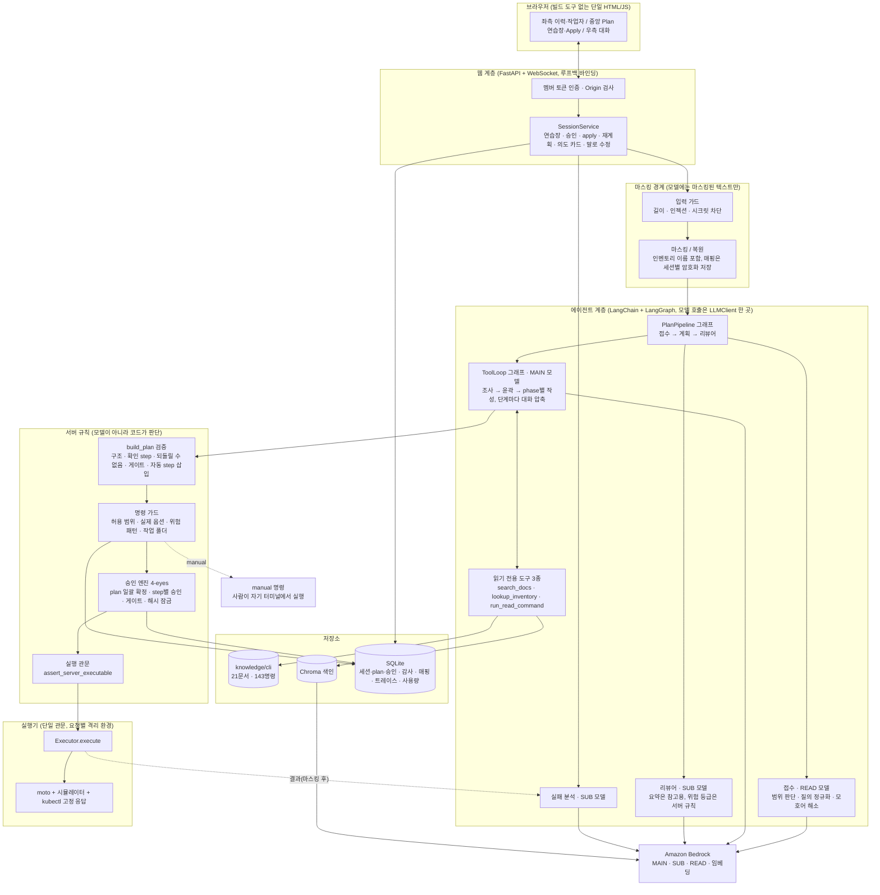
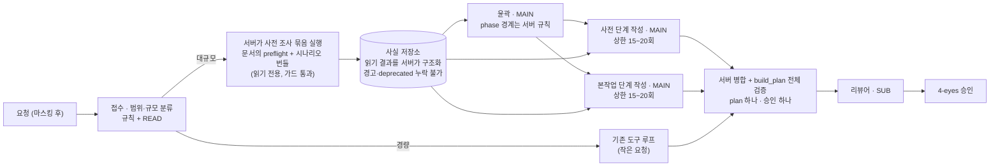
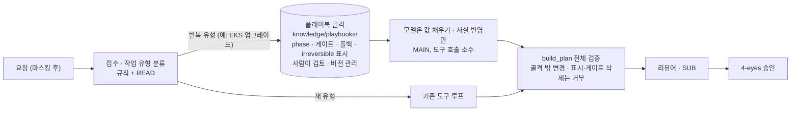
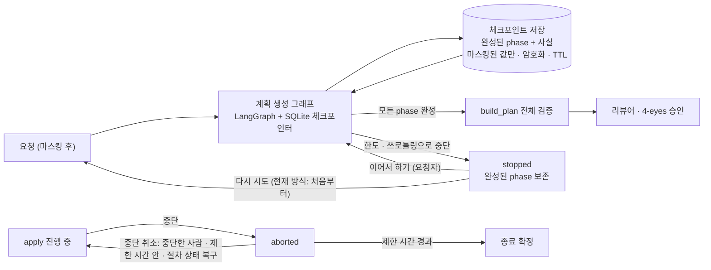
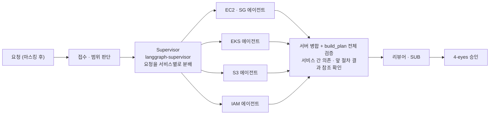

# SERVICE · DevOps Plan/Apply Agent

## 1. 목적
AWS 인프라 운영의 반복 작업(작업 계획 생성, CLI 작성)을 모델로 자동 생성하고, 사람이 확인·승인한 뒤 서버가 실행한다. 2인 1조 작업을 위해 브라우저로 세션을 공유한다.

**한 줄 목표:** 자연어 요청을 마스킹된 상태로 모델에 전달해 사내 CLI 문서(EC2/SG·EKS·S3·IAM)에 근거한 AWS CLI/kubectl 작업 계획(변경 step마다 확인 step 포함)을 생성하고, 사람이 커스텀 step을 추가·수정할 수 있게 하며, 링크로 공유한 두 사람의 세션에서 plan은 일괄 승인, apply는 step마다 다른 사람이 승인하는 4-eyes로 서버(우선 moto + kubectl fixture)가 실행하는 로컬 웹 도구.

## 1-1. 기술 스택
2026-11-06 기준. **사용 중**은 코드에서 실제로 쓰는 것, **예정**은 설치만 했거나 계획 단계인 것이다(`requirements.txt`에 있어도 앱이 import하지 않으면 사용 중이 아니다).

| 영역 | 기술 | 상태 |
|---|---|---|
| 언어·환경 | Python 3.14, `.venv`(앱), `.venv-eval`(RAGAS 전용) | 사용 중 (`.venv-eval`은 예정) |
| LLM | Amazon Bedrock. 모든 모델 호출은 `langchain-aws`: 에이전트는 `ChatBedrockConverse`(`app/llm.py`), 리랭크도 `ChatBedrockConverse`(`app/rag/reranker.py`), 임베딩은 `BedrockEmbeddings`로 Titan v2(`app/rag/embedder.py`). 모델은 `.env`의 `MAIN`/`SUB`/`READ` | 사용 중 |
| 에이전트 | LangChain + LangGraph(D-55): `LLMClient`(`app/llm.py`)가 `langchain-core` 메시지로 `ChatBedrockConverse`를 호출하는 한 곳, 도구 루프(`app/planner/toolloop.py`)와 접수→계획→리뷰 파이프라인(`app/planner/pipeline.py`)은 `StateGraph`, 읽기 도구는 LangChain `StructuredTool`. 접수·리뷰어·말로 수정의 단발 호출은 "호출 → 스키마 검증 → 재시도"를 `app/planner/structured.py`의 그래프가 맡는다. 계획·실패 분석 도구 루프는 프롬프트 캐싱(D-56). 가드·마스킹·승인·한도는 바꾸지 않았다 | 사용 중 (`langgraph-supervisor`는 Phase 2) |
| 검색 | BM25(`rank-bm25` + `kiwipiepy`) + Titan 벡터(`chromadb`) + RRF + LLM 리랭크 | 사용 중 |
| 가드레일 | 자체 구현(`app/guards/`), `pydantic` | 사용 중 |
| 웹 | FastAPI + uvicorn, WebSocket, 빌드 도구 없는 단일 HTML/JS | 사용 중 |
| 패키징 | Docker(Python 3.14 + AWS CLI v2 + kubectl + 앱 패키지를 한 이미지에, `requirements-runtime.txt`). 직접 설치 실행도 가능 | 사용 중(D-54, WSL2 Docker에서 빌드·실행 확인) |
| 저장 | SQLite(감사 기록, 암호화 매핑 저장소, 세션·plan 이력), Chroma 색인, `cryptography`(AES-GCM) | 사용 중 |
| mock 실행 | moto server + 시뮬레이터 + kubectl 고정 응답, 단일 관문 실행기(`app/executor/`) | 사용 중 |
| 관측 | 로컬 트레이스(`data/trace.sqlite`, 메타데이터만, D-60) 구현. Langfuse는 구현하지 않음(요청하면 시작 거부) | 로컬 사용 중 / Langfuse 예정 |
| 평가·테스트 | `pytest`, `eval/` 스크립트(검색·에이전트 규칙 채점), LLM-as-Judge, RAGAS | pytest·스크립트·규칙 채점 사용 중, Judge는 구현했으나 미측정 / RAGAS 예정 |

- `ref/`는 스택을 고를 때 참고한 교육 예제(사용자 요청)이고 앱이 import하지 않는다. 참고할 예제 목록은 `docs/IMPLEMENTATION.md` 5절.
- `requirements.txt`의 MCP 패키지(`mcp`, `fastmcp`, `langchain-mcp-adapters`)와 `langgraph-supervisor`·`langgraph-checkpoint-sqlite`는 교육 패키지 목록에서 설치됐을 뿐 앱 코드가 import하지 않는다(전환 결정과 쓰지 않는 것은 D-55). 에이전트의 모델 호출은 `app/llm.py` 한 곳이고, 검색의 임베딩·리랭크(`app/rag/embedder.py`·`reranker.py`)도 `langchain-aws`를 쓴다. 모델 제공자는 Bedrock이다. 선택의 이유와 대안은 `docs/DECISIONS.md`(D-04, D-14, D-15, D-16, D-27).

> ## 현재 한계와 개선 과제
> 2026-11-06 기준. Phase 1(로컬 + mock)은 **동작하지만 큰 작업에서 완성도가 낮은 부분이 있다.** 측정한 사실과 짐작을 구분해 [12절(현재 아키텍처)](#12-현재-아키텍처-phase-1), [13절(문제점)](#13-문제점-측정-근거), [14절(개선 방향과 대안 아키텍처)](#14-개선-방향과-대안-아키텍처)에 정리했다. 결정 이유와 시도했다 되돌린 것은 `docs/DECISIONS.md`(D-55~D-65)에 있다.
>
> | # | 한계 | 근거 | 방향(14절) |
> |---|---|---|---|
> | 1 | **큰 계획(EKS 업그레이드)이 무겁고 불안정하다**: 한 건에 도구 호출 22~30회·약 26~50만 토큰, 호출 상한 30회에 걸려 같은 케이스가 2회 중 1회만 끝까지 간다 | D-57·D-58·D-64 재측정, 평가 #9 | 결정적 사전 조사 + 사실 저장소 + 단계 분할 |
> | 2 | **요청을 사전/사후로 나눠도 총 사용량이 줄지 않는다**(약 2.5배). 그래서 "나눠서 요청" 안내는 뺐다 | D-59 실측, D-63 | 단계 사이에 사실을 넘기는 구조일 때만 감소 가능(미측정) |
> | 3 | **생성이 한도로 멈추면 이어서 할 수 없다**("다시 시도"는 처음부터). 중단(aborted)도 되돌릴 수 없다 | 코드·상태 전이표 | 체크포인트, 중단 취소(미결정) |
> | 4 | **같은 뜻의 요청이 표현에 따라 다른 결과가 나온다**(예: 태그 달아 생성 → `create-tags` 별도 호출 vs `--tag-specifications`). 모델이 문서에 없는 명령을 추정하기도 한다 | 2026-11-06 사례, 문서 보강 | 문서·플레이북 보강, 평가 케이스 확대 |
> | 5 | **되돌릴 수 없는 단계의 표시가 모델에 의존한다**(`iac`·`manual`). 서버 검증은 좁은 키워드만 잡는다 | 평가 #9, D-64 | 플레이북·서버 규칙 확대 |
> | 6 | **버전별 deprecated는 에이전트가 알지 못한다.** AWS 업그레이드 인사이트 조회 결과에 의존하고, mock 환경의 응답은 시뮬레이터 값이다. 공식 문서는 연동하지 않았다 | 구조, D-65 | 실제 AWS 연동 단계(Phase 2~3)에서 검증 |
> | 7 | **실제 AWS에서 검증하지 않았다**(mock만). 인증은 닉네임 자기 신고, 서버는 루프백 전용이다 | 7·2절 | Phase 3 |
> | 8 | **평가의 한계**: 42건·케이스당 1회, 규칙 채점만(Judge·사람 일치도 미측정), 정정한 뒤의 값(97.6%)은 재측정이 아니다 | README 평가 절 | Judge 측정, 반복 측정 |
> | 9 | **화면**: 가짜 DOM 테스트와 수동 확인 중심이고 게이트 해제 화면은 브라우저에서 확인하지 못했다. 종료된 작업의 상세 보기·파일 내용 표시(`show_file_contents`)는 미구현 | TASK.md | UI 정리 |

## 2. 사용자와 세션
- 링크 초대로 세션 참여. 로그인 없음, 입장 시 닉네임 입력으로 사용자 구분.
- 두 사람이 같은 화면(요청, 계획, 승인, 실행 결과)을 실시간 공유(WebSocket).
- **한계:** 닉네임은 자기 신고 방식이므로 실제 운영 전 인증(SSO 등) 필요.

## 3. 처리 흐름
1. 사용자 요청 입력 → 입력 가드(인젝션/범위 밖 요청 거절) → 마스킹.
2. 질의 정규화(LLM, 구조화 출력): 서비스·동작·대상·파라미터를 뽑고 '서버'·'노드'는 항상 EC2 인스턴스, Pod은 Pod으로 구분한다(D-31). 모호한 표현(`방화벽`, `권한`, `서비스` 등)은 서버가 탐지한다. 요청 문장 안의 근거로 해석이 분명하면 모델이 해소하고 서버가 검증하며(D-30), 그렇지 않으면 되묻는다. 해소한 해석은 사용자에게 보이고 이력에 남긴다. 검색 품질을 올리는 단계가 아니다.
3. **계획 에이전트**가 목표를 step으로 분해하고 의존성을 설계한다. 읽기 전용 도구(문서 검색, 인벤토리 조회, 읽기 명령 실행)를 직접 호출하고, 검색 결과가 부족하면 질의를 바꿔 재검색한다. 검색은 하이브리드 + LLM 리랭크(`docs/IMPLEMENTATION.md` 2절).
4. 근거 기반 명령 생성. 모호하거나 필수 파라미터가 없으면 되묻고, 근거가 없으면 폴백(AI 추정 표시). 현재 상태 조회 결과에 따라 step을 조정한다(예: 이미 규칙이 있으면 건너뜀).
4-1. **리뷰어 에이전트**가 영향 범위, 위험(prod, 삭제, 광범위 CIDR), 누락된 롤백을 점검해 승인자용 요약을 만든다. 참고용이며 승인 규칙을 대체하지 않는다.
5. 명령 가드(6절): 허용 범위, 실제 CLI에 있는 옵션, 금지 옵션, 위험 패턴, 미복원 플레이스홀더를 검사한다.
6. 변경 step마다 짝 확인(읽기) step을 만들어 계획(step 목록)을 완성한다. 앞 step이 새로 만드는 리소스의 ID(보안 그룹 `GroupId` 등)는 `@{step-id.필드}`로 참조하며, 서버가 apply에서 앞 step이 끝난 뒤 그 출력의 리소스 ID만 꺼내 넣는다(D-48, 승인되는 것은 참조가 적힌 템플릿).
7. **Plan(연습장, D-47):** 자유롭게 쓰고 고치는 곳. 명령을 직접 쓰거나(`＋ 직접 입력`), 문서에서 찾아 필수 값을 채우거나(`＋ 명령 만들기`, 서브넷·AMI 등은 조회로 고름), 대화로 "apply 진행해줘"·"다음 절차 실행해줘"처럼 진행을 요청하면(실행 제안 카드를 사람이 눌러야 실행, D-49) 말로 고치거나, 에이전트에게 초안을 요청하거나(빠진 값은 되묻지 않고 기본값으로 만들며 "가정: …"을 적는다), 말로 고쳐 달라고 한다(수정안을 사람이 수락). 초안은 틀려도 저장되고 ✔/⚠/⛔ 상태와 확정하지 못하는 이유만 보인다. 요청자가 절차(변경+확인 묶음)를 **검토 요청에 포함**하고 `검토 요청`을 누르면 서버가 전체 검증을 해 plan이 되고, 요청자가 아닌 확인자가 그 목록을 **확정(일괄 승인)**해야 해시로 잠기고 apply로 갈 수 있다(화면 용어, D-47 보완 5). 제목만으로 빈 plan을 시작할 수도 있다. 읽기 명령은 실행해 결과를 보이고 변경은 실행하지 않는다.
8. **Apply:** step마다 다른 사람이 승인 → 실행 → 확인 step 자동 실행. 확인 실패 시 중단 후 재시도/건너뛰기/중단 선택. 도중에 계획을 바꿔야 하면 3-2절의 부분 재계획. `manual` step에서는 멈추고, 요청자가 자기 터미널에서 실행해 "실행 완료"를 보고(결과 붙여넣기는 선택, 가드·마스킹 적용)하면 다른 사람이 확인하고 진행한다.
9. 요청·계획·근거·승인·실행·확인 결과를 SQLite에 저장.

## 3-1. 에이전트 구조 (Phase 1)
| 에이전트 | 역할 | 도구 |
|---|---|---|
| 계획 에이전트 | 목표 분해, 의존성 설계, 명령 생성, 상태 기반 조정 | 문서 검색, 인벤토리 조회, 읽기 명령 실행 |
| 리뷰어 에이전트 | 계획의 위험·영향 범위·롤백 누락 요약 | 없음(계획만 입력) |
| 실패 분석 에이전트 | apply 실패 시 원인 분석과 대안 step 제안. 서버가 오류를 분류하고 추천(재시도·건너뛰기·중단·재계획)을 규칙으로 좁힌다(권한·인자 오류는 재시도 불가, 시도 횟수 상한, 의존 step이 있으면 건너뛰기 불가, 변경 step의 시간 초과는 상태 확인 먼저, D-37) | 읽기 명령 실행 |

- 계획 에이전트는 phase 윤곽을 먼저 만들고 phase를 하나씩 만든다. 서버가 매번 계획을 검증하고 오류 코드를 돌려줘 고치게 하며, 수정 기회가 끝나거나 상한에 걸리면 중단하고 사람에게 넘긴다(D-32).
- 모델: 계획은 MAIN, 리뷰어·실패 분석은 SUB, 질의 정규화·범위 판단·리랭크·읽기 출력 요약 같은 가벼운 일은 READ. MAIN이 쓰로틀링이면 재시도 후 SUB로 진행한다(가드·한도는 그대로, D-19).
- 에이전트는 제안만 한다. 도구는 읽기 전용이고 변경 실행은 승인 엔진을 통해서만 가능하다.
- 실패 분석의 대안 step은 일반 step과 같이 승인을 거치며, "중단 후 plan으로 복귀해 재승인"의 입력으로만 쓴다(승인된 plan 해시와 충돌하지 않게).
- 서비스별 전문 에이전트 + supervisor는 Phase 2 후보(서비스 약 8개 이상, 또는 서비스별 정확도 저하 시). 대비로 문서를 서비스별로 나누고 계획 에이전트를 인터페이스 뒤에 둔다.

## 3-2. 대규모 작업 (단계·게이트·부분 재계획)
EKS 업그레이드처럼 step이 많고 오래 걸리는 작업을 위한 구조.
- **구조:** plan → phase → step. phase는 목적, 사전 조건(preflight), 게이트, 롤백 방법을 가진다. plan·phase당 step 수에 상한이 있고 넘으면 분할을 요청한다.
- **step 종류:** `cli`(read/mutate, 서버 실행), `manual`(문구만 제공, 사람이 실행), `iac`(코드 변경과 terraform plan/apply를 사람이 수행), `check`(체크), `poll`(상태 확인 반복).
- **게이트:** 위험한 phase(컨트롤 플레인 업그레이드, 노드 교체 등) 진입 전에 앞 phase 결과를 보여주고 요청자가 아닌 사람이 진행을 확인한다. 위치는 리뷰어가 제안하고 `impact`로 보강한다. 게이트는 추가할 수 있고, `reversible: irreversible` step(문서 `impact`, 또는 문서 정보가 없는 `iac`·`manual` step에 모델이 표시한 것)을 포함한 phase의 게이트는 사람이 사유를 적어야만 해제할 수 있다(해제 사유는 plan 해시·승인 화면에 남고 위험 등급이 높음, 모델 출력으로는 해제되지 않음, D-64). 컨트롤 플레인·클러스터 버전 변경이나 클러스터 삭제로 보이는 `iac`·`manual` step에 되돌릴 수 없음 표시가 없으면 서버가 검증 실패로 돌려 고치게 한다.
- **사전 점검:** 변경 step의 `impact.preflight`를 읽기 step으로 phase 앞에 넣어 plan 단계에서 실행하고 결과를 보여준다. `dry_run`이 있으면 사전 검증 step을 제안한다.
- **오래 걸리는 step(`long_running`):** `poll` step으로 간격을 두고 반복 조회한다(간격·최대 시간·완료 조건은 문서에 정의). 최대 시간을 넘으면 중단하고 알린다. 진행 상태는 SQLite에 저장되어 서버가 재시작돼도 이어진다.
- **부분 재계획:** apply 중 직접 수정은 불가하다. 실패하거나 계획을 바꿔야 하면 일시정지하고, 완료된 step은 잠근 채(수정 불가, 결과 보존) 남은 step만 새 plan 버전으로 수정해 다시 승인받아 재개한다. 새 버전은 완료된 step의 해시를 이어받아 "승인된 내용 = 실행된 내용"을 유지한다.
- **IaC 동기화:** `iac_managed: true`이면 `impact.iac: true`인 CLI 변경 step 뒤에 "코드 동기화 확인" 수동 step을 자동 추가하고, CLI 직접 변경이 코드와 어긋날 수 있다는 경고와 `iac` step으로 대체할 수 있는지 검토를 요청한다.
- **`iac` step:** 도구는 바꿀 코드 항목 체크리스트와 사전·사후 읽기 점검만 제공하고, 사람이 코드 수정(PR), `terraform plan` 검토, `apply`를 하고 완료를 보고한다. plan 출력을 붙여넣으면(선택) 입력 가드·마스킹 후 리뷰어가 교체·삭제 항목을 요약한다. Terraform 직접 연동은 Phase 3.
- **리뷰어 체크리스트(phase별):** 사전 조건, 영향(`disruption`/`replaces`/`reversible`), 롤백 경로, 코드 동기화 필요 여부, 게이트 위치.

## 3-3. 운영 환경 가정 (사용자 제공, 2026-11-04)
- 쿠버네티스 노드는 ASG 기반 self-managed다(EKS 관리형 노드그룹이 아님). 노드 교체는 AMI를 바꾼 launch template과 ASG 인스턴스 리프레시로 한다.
- 인프라 변경은 Terraform이 주도한다. kubectl 수작업(rollout 등)이 있으나 코드와 항상 동기화하며, 상태가 코드와 달라지면 안 된다.
- 따라서 CLI로 리소스를 직접 바꾸는 계획에는 IaC 동기화 step이 들어간다. 관리형 노드그룹 문서(`knowledge/cli/aws/eks/nodegroup.md`)는 이 환경에서 쓰지 않는다.

## 4. 승인 정책 (4-eyes)
| 명령 | 승인 |
|---|---|
| 읽기(describe/list/get) | 요청자 직접 실행 가능. apply에서는 문서 근거가 있고 추가 조치가 없는 읽기(사전 점검 포함)를 "확인" 한 번으로 진행 |
| 변경(create/delete/apply/modify 등) | 요청자가 아닌 사람의 승인 필수. 단 저위험 변경(문서 근거 있음, 위험 high 아님, 중단·교체·되돌릴 수 없음 없음, 추가 조치·강한 경고 없음, IaC 불일치 안내는 무관)은 확인자가 plan을 확정할 때 절차별 승인도 함께 하며(D-50) apply에서는 ▶ 실행만 한다 |
| 폴백(문서 근거 없음, AI 추정) | 읽기/변경 구분 없이 항상 다른 사람 승인 |
| 분류가 애매함 | 변경으로 취급 |
| 전체 개방(`0.0.0.0/0`) 포함 | 사유 입력 + 승인자 별도 확인 필수 |
| IaC 변경(`iac` step) | 서버는 실행하지 않음. plan 일괄 승인 + 게이트에서 코드 PR·plan 결과 검토, 완료 보고 → 다른 사람 확인 |
| 수동 실행(`kind: manual`) | 서버는 실행하지 않음. plan 일괄 승인 때 명령 문구 검토 + apply에서 요청자의 "실행 완료" 보고 → 다른 사람 확인 |
| 게이트 phase | 앞 phase가 모두 끝난 뒤 요청자가 아닌 사람이 진행 확인(되돌릴 수 없는 step이 있으면 사람이 사유를 적어야만 게이트를 해제할 수 있고 해제 사유가 승인 화면에 보임, D-64) |
| plan 반려 | 요청자가 아닌 확인자가 코멘트(전체 필수, 절차별 선택)와 함께 plan을 돌려보내면 요청자가 연습장에서 고쳐 다시 검토를 요청한다(검토 중·승인 뒤 apply 전에만, 요청자는 불가) |
| 실패 후 재시도 | 일시적인 오류만, 시도 3회 미만, 적용됐을 수 있는 변경은 상태 확인 보고 후, 다시 승인 필요 |
| 실패 후 건너뛰기 | 요청자가 아닌 사람, 의존하는 step이 없을 때만 |
| poll step | 서버가 간격을 두고 읽기 명령을 반복, 최대 시간을 넘기면 중단, 완료는 사람이 최신 결과를 보고 확인 |
| 서버 재시작 | 진행 중이던 poll은 이어서 조회, 그 밖의 실행 중 step은 중단 처리 후 상태 확인 |

## 5. 커스텀 step
직접 입력 CLI(연습장에서는 틀려도 저장하지만 확정·plan 전송은 가드 통과 필수, "수동 입력" 표시), 자연어로 생성한 step(초안 요청, 말로 수정), 수동 체크 step(실행 없음), 생성 step 수정·순서변경·삭제(단계 사이 이동 포함).

## 6. 가드레일
입출력 가드레일은 필수이며 우회·완화·비활성화할 수 없다. 가드가 오류를 내거나 판정이 불확실하면 통과가 아니라 차단하고 사람에게 알린다(fail-closed). 규칙은 `CLAUDE.md`의 "불변 규칙", 구현은 `docs/IMPLEMENTATION.md` 1절.

서비스가 보장하는 것:
- **모델에 민감값이 가지 않는다.** 계정 ID, ARN, 리소스 ID, 키, IP/CIDR, 이메일, 리소스 이름(인벤토리)은 플레이스홀더(`<CLUSTER_1>`)로 바꿔 전달하고, 승인 화면과 실행 단계에서만 서버가 복원한다. prod 대상은 서버 규칙으로 판별해 경고한다.
- **입력과 신뢰하지 않는 데이터를 검사한다.** 인젝션·가드 우회·비밀값 입력을 막고, 문서·도구 결과·실행 출력 안의 지시는 따르지 않는다.
- **명령은 허용 범위 안에서만 만들어진다.** 문서에 있는 서비스, 실제 CLI에 있는 옵션, 작업 폴더 안의 경로만 허용하고 대상·자격증명을 바꾸는 옵션, 종료되지 않는 명령, 시크릿 노출 경로는 막는다.
- **위험한 변경은 추가 통제를 받는다.** 전체 개방(`0.0.0.0/0`)은 허용하되 위험 표시, 사유 입력, 승인자 별도 확인, 이력 기록이 필요하고 리뷰어 요약에도 포함된다(포트 무관, 관리 포트 예외 없음). 와일드카드 삭제·광범위 IAM 권한 등은 차단하거나 강하게 경고한다.
- **앞 절차 결과 참조는 좁게만 쓴다.** 치환되는 값은 서버가 실행해 끝난 앞 절차 출력의 리소스 ID 모양 값뿐이고(이름·ARN·IP·임의 문자열 거부), 치환한 명령은 가드와 실행기 관문을 다시 통과하며, 에이전트 읽기 도구·미리보기·사람이 하는 절차에서는 쓸 수 없다(D-48).
- **서버가 실행하지 않는 명령이 있다.** `kind: manual`은 문구만 보여주고 사람이 자기 터미널에서 실행한다(폴백 포함). 시크릿은 입력으로도 출력으로도 시스템에 들어오지 않는다.
- **에이전트는 제한된 범위에서만 동작한다.** 읽기 전용 도구만 쓰고 호출·단계·토큰·시간 상한과 반복 감지가 있으며, 상한을 넘으면 중단한다.
- 모호한 표현(`ambiguous`)은 근거가 분명할 때만 해소하고 아니면 되묻는다. 모든 가드 판정은 이력에 기록한다.
- **한계:** 인벤토리에 없는 리소스 이름은 마스킹되지 않을 수 있다.

## 7. 실행 환경 (Phase 1: mock)
- AWS CLI → 루프백 moto server(실행기가 `AWS_ENDPOINT_URL`과 더미 자격증명을 지정, 서버의 환경변수는 상속하지 않음). 실제 AWS 호출 금지.
- moto가 지원하지 않는 명령(EKS 업그레이드, ASG 인스턴스 리프레시 등)은 상태를 가진 시뮬레이터가 대신하고, 진행은 조회 횟수로 센다(D-36).
- kubectl → 고정 응답(fixture). moto의 EKS는 메타데이터만 지원하며 K8s API는 없다.
- 실행기는 인터페이스로 분리해 이후 실제 실행기로 교체한다. 요청은 직렬화 가능한 `ExecutionRequest`로 다루고 kubeconfig·자격증명은 요청(세션)별로 격리한다. 실행은 단일 관문(`Executor.execute`)만 거치고 실행하는 쪽에서 가드를 한 번 더 통과시킨다. 실행 위치(이 서버 직접 vs 권한 서버에 요청)는 Phase 3 전까지 미정이다(D-28).

## 8. 지식베이스
`knowledge/cli/`에 직접 작성한 마크다운(CLI 도구별 → 서비스별). 작성 규격(frontmatter, `kind`, `risk`, `impact`)과 검증 항목은 `knowledge/cli/SCHEMA.md`.
```
knowledge/cli/
  aws/{ec2,eks,s3,iam,autoscaling,ssm}/   주제별 파일 (예: ec2/security-group.md, s3/s3.md, s3/s3api.md)
  kubectl/                get-describe.md, apply-delete.md, rollout.md ...
  glossary.yaml           용어 사전 (sg, 시큐리티그룹, 방화벽 → Security Group)
```
- `impact`는 승인 화면 경고, 사전 점검 step 자동 삽입, 리뷰어 요약의 근거다. 영향 정보가 없는 명령(폴백 포함)은 "영향 불명"으로 높은 위험 취급한다.
- EKS는 클러스터 관리(`aws/eks`)와 워크로드 조작(`kubectl`)을 분리한다. 실행기도 aws → moto, kubectl → 고정 응답으로 나뉜다.

## 9. 평가와 관측
- 평가는 규칙 기반, 검색 지표, LLM-as-Judge의 3층이다. 검색은 80여 개 케이스(`eval/retrieval_cases.yaml`)로 hit@k를, 에이전트는 42개 케이스(`eval/agent_cases.csv`)를 실제 서비스 경로로 돌려 규칙 채점한다(통과 기준: 정확도 90% 이상, guardrail 100%, 오류는 분모에서 제외하되 20% 초과 시 무효, D-61). 첫 측정은 90.0%(guardrail 100%)였고 Judge 채점과 사람 일치도는 아직 측정하지 않았다(결과·한계는 README, 13절 8번).
- 관측은 기본 `local`(`TRACE_BACKEND=off`로 끌 수 있음)이고, 트레이스에는 메타데이터(모델 호출의 토큰·폴백·지연, 도구 호출 이름·성공, 계획 결과 코드·해시)만 기록하며 자유 문장은 저장하지 않는다. Langfuse는 개발 단계 한정 계획이고 아직 구현하지 않았다(D-60).
- 평가 데이터에는 플레이스홀더만 쓰고 RAGAS는 평가 전용 환경에서만 실행한다. 상세와 기준값은 `docs/IMPLEMENTATION.md` 4절.

## 10. 로드맵
- **Phase 1 (현재):** 위 내용 + plan/apply 이력 저장(재사용 대비 스키마). 남은 한계는 문서 맨 위 표와 13절.
- **Phase 1.5 (제안, 구현 안 함):** 큰 계획의 호출·토큰 문제를 줄이는 구조 개선(결정적 사전 조사, 사실 저장소, 단계 분할, 플레이북 골격, 중단 후 재개). 14절, `docs/DECISIONS.md` D-65. 먼저 현재 구조의 분포를 측정한다.
- **Phase 2:** 이력 기반 계획 재사용(LLM 호출 최소화, 승인·성공 이력만), 엑셀 계획서 import·분석·저장(형식 확인 필요), 서비스별 전문 에이전트 + supervisor(서비스 약 8개 이상 또는 서비스별 정확도 저하 시). 에이전트 계층은 Phase 1에서 이미 LangGraph로 구현했고(D-55), supervisor는 그 그래프 위에 `langgraph-supervisor`로 얹는다.
- **Phase 3:** 사내 테라큐브·GitHub repo 코드 수정/PR 생성(병합은 사람), AWS role 분리(plan=읽기, apply=변경) 및 실제 인증, Terraform plan/apply 연동(`iac` step 자동화). 테라큐브 연동 방식은 미확인.

## 11. 미확인/가정
- 엑셀 형식, 테라큐브 인터페이스, 서버 실행 위치(D-28), 큰 계획의 구조 개선(14절, 측정 전). 정확도 목표(90%·guardrail 100%)와 에이전트별 모델 매핑(MAIN·SUB·READ)은 확정했다(D-61, D-19).
- 현재 1인 검증(탭 2개, 다른 닉네임).

## 12. 현재 아키텍처 (Phase 1)
2026-11-06 기준 구현된 구조다. 구성요소의 모듈은 `docs/IMPLEMENTATION.md`, 정책은 이 문서의 2~9절과 `CLAUDE.md`에 있다.



**계층별 책임**

| 계층 | 책임 | 하지 않는 것 |
|---|---|---|
| 웹 | 인증(멤버 토큰), Origin·루프백 검사, 메시지 라우팅, 세션 상태 | 모델 호출, 명령 판단 |
| 마스킹 경계 | 입력 검사, 민감값 ↔ 플레이스홀더 변환, 매핑 암호화 보관 | 의미 판단 |
| 에이전트 | 접수 · 계획 · 리뷰 · 실패 분석 · 말로 수정. **제안만** 한다 | 승인, 실행, 가드 우회 |
| 서버 규칙 | 계획 구조 검증, 명령 가드, 승인 자격, 실행 관문. fail-closed | 모델 판단에 의존하는 안전 결정 |
| 실행기 | 승인된 명령 하나를 격리 환경에서 실행. 가드를 한 번 더 통과 | 승인 판단, 서버 전역 상태 변경 |
| 저장소 | 지식(원본), 색인, 이력·감사·매핑·트레이스·사용량 | 원본 데이터 보관(`data/`는 지워도 재생성) |

**신뢰 경계와 데이터 흐름**
1. 사용자 입력은 입력 가드 → 마스킹을 거친 뒤에만 모델로 간다. 실제 값은 서버·세션 안에만 있고 승인 화면과 실행 단계에서만 복원된다.
2. 문서·도구 결과·실행 출력은 신뢰하지 않는 데이터다. 마스킹·정리·데이터 틀을 거쳐서만 모델로 돌아간다.
3. 모델의 출력(윤곽, phase, step)은 제안이다. `build_plan`이 구조를 검증하고, 명령 가드가 명령을 검사하고, 사람이 승인한 것만 실행 관문을 통과한다.
4. 승인된 내용 = 실행된 내용이다(plan 해시 잠금, 앞 절차 결과 참조는 템플릿 그대로 승인).

**모델 호출 지도** (역할은 `.env`의 `MAIN_MODEL`·`SUB_MODEL`·`READ_MODEL`로 지정)

| 호출 | 모델 | 도구 | 프롬프트 캐시 |
|---|---|---|---|
| 접수(범위 판단·정규화) | READ | 없음 | 아니오 |
| 계획 도구 루프(조사·윤곽·phase 작성) | MAIN (쓰로틀링이면 SUB로 폴백) | 읽기 도구 3종 | 예(D-56) |
| 리뷰어 요약 · 말로 수정 | SUB | 없음 | 아니오 |
| 실패 분석 | SUB | 읽기 명령 | 예 |
| 검색 리랭크 | READ | 없음 | 아니오 |
| 임베딩 | Titan v2 | 없음 | 해당 없음 |

**한 요청의 비용 구조(실측, 2026-11-05~06)**: 호출 한 번의 고정 입력이 약 9k 토큰이라 호출 수가 곧 비용이다. 간단한 요청은 1~6만 토큰, EKS 업그레이드 같은 큰 계획은 26~50만 토큰이다. 프롬프트 캐시는 입력 환산 약 29%만 줄였다(D-56).

## 13. 문제점 (측정 근거)
요약은 문서 맨 위 표에 있다. 여기서는 근거와 현재의 완화책, 남은 위험을 적는다. "측정"은 실제 모델·mock 실행기로 돌린 결과이고 "추정"은 구조에서 짐작한 것이다.

| # | 문제 | 근거(측정/추정) | 현재 완화 | 남은 위험 |
|---|---|---|---|---|
| 1 | 큰 계획의 호출·토큰이 크고 상한에 걸린다 | 측정: EKS 한 건 도구 호출 22~30회·26~50만 토큰, #9는 D-64 재측정 2회 중 1회 `tool_calls_exceeded`(45만 토큰 소진 후 중단) | 읽기 결과를 요약으로 다시 주는 압축(D-57), 중복 제거(D-58), 캐시(D-56) | 상한 30회에 가까워 변동이 크다. ②(중복 제거)의 토큰 절감 효과는 입증하지 못했다 |
| 2 | 나눠도 합계가 줄지 않는다 | 측정: 사전 349,518 + 사후 347,428 토큰 vs 한 번에 26~30만(약 2.5배) | "나눠서 요청" 안내를 삭제(D-63) | 단계 사이에 사실을 넘기는 구조가 없다 |
| 3 | 중단 뒤 이어서 할 수 없다 | 코드: "다시 시도"는 같은 요청으로 처음부터. `aborted`는 종료 상태 | 평가 실행기는 케이스 단위로 이어 돌림 | 한도에 걸리면 쓴 토큰이 전부 버려진다. 중단 버튼 오클릭 복구 불가 |
| 4 | 표현에 따라 결과가 달라진다 | 측정(2026-11-06): "생성해서 Name 태그에 붙여줘" → `create-tags`(문서에 없음, 초안 4개), "생성하면서 태그도 함께" → `--tag-specifications`(초안 2개). 보강 뒤 둘 다 한 명령으로 일치(각 1회) | 문서 보강(`tags.md`, 예시·키워드), 검색 평가 케이스 추가 | 같은 케이스도 실행마다 다를 수 있다(모델 변동). 문서에 없는 명령은 AI 추정 폴백으로 간다 |
| 5 | 되돌릴 수 없음 표시가 모델에 의존한다 | 측정: #9에서 컨트롤 플레인 변경 `iac` 절차에 표시 누락 → 게이트가 잠기지 않았다. 코드: 연습장은 잠긴 게이트를 저장하지 않아 화면 값과 plan 값이 달랐다 | D-64: 표시 누락 서버 검증(좁은 키워드), 게이트 해제는 사유 필요, 연습장 표시=plan 값 | 키워드 밖의 되돌릴 수 없는 `iac` 작업은 여전히 모델이 표시해야 한다. 사유는 자유 문장 |
| 6 | 버전별 deprecated를 에이전트가 모른다 | 구조: 근거는 AWS 업그레이드 인사이트 조회와 add-on 호환 조회 결과. 모델의 사전 지식은 최신 버전을 모를 수 있다. 문서(knowledge)에는 버전별 deprecation 목록이 없다 | 계획에 인사이트·add-on 조회 절차를 넣고 1.36 고유 내용 단정을 평가에서 금지 | mock의 인사이트 응답은 시뮬레이터 값이라 실제 탐지 정확도는 검증하지 못했다. 인사이트 경고에 따른 분기는 규칙으로 강제하지 않는다 |
| 7 | 실제 환경 미검증, 인증 약함 | mock(moto·시뮬레이터·kubectl 고정 응답)만 실행. 닉네임 자기 신고, 루프백 전용 | 루프백 바인딩·Origin 검사·멤버 토큰, 실행기 격리 | 실제 AWS의 오류·지연·권한 모델은 모른다. 실행 위치 미정(D-28) |
| 8 | 평가의 신뢰도 | 측정: 42건·케이스당 1회·규칙 채점, 첫 측정 90.0%(36/4/2), 정정 후 합산 97.6%(재측정 아님). Judge·사람 일치도 미측정 | 오류는 분모에서 제외하되 20% 초과 시 무효, 기대값은 완화하지 않음(D-61) | 표본이 작고 모델 변동이 크다. 입력·환경 오류로 보인 케이스도 있었다 |
| 9 | 화면 완성도 | 테스트: 가짜 DOM + 실제 Chrome 수동 확인. 게이트 해제 화면은 미확인 | 렌더 테스트 | 이력 조회·종료 작업 상세·`show_file_contents`(파일 내용 표시, 승인 시점 해시 고정 필요) 미구현 |
| 10 | 관측의 한계 | 구현: 로컬 트레이스(메타데이터만), Langfuse는 요청하면 시작을 거부 | D-60 | 외부 트레이스 도구 연동 없음. 비용·지연 대시보드 없음 |
| 11 | 일일 토큰 한도 | 측정: 평가 중 MAIN 쓰로틀링으로 중단된 적이 있다. 남은 한도는 조회할 수 없다 | 쓰로틀링 시 SUB 폴백(D-19), 평가 사전 점검과 이어서 실행 | 큰 작업 중간에 한도에 걸릴 수 있다 |

## 14. 개선 방향과 대안 아키텍처
**구현하지 않은 검토 기록이다.** 근거 없는 낙관을 피하려고 측정한 값과 짐작을 구분했고, 시도했다 되돌린 것도 남긴다. 후보별 비교표는 `docs/DECISIONS.md` D-65.

### 14-1. 문제의 뿌리
- 현재는 **하나의 도구 루프가 조사부터 모든 phase 작성까지 한 대화로 끌고 간다.** 호출마다 고정 입력(약 9k)이 반복되고 호출 수에 상한(30)이 있어, 조사를 많이 해야 하는 큰 계획이 구조적으로 취약하다.
- 조사의 대부분은 요청과 무관한 **반복되는 사실 수집**(현재 버전, 노드, add-on, 서브넷, ASG)이다. 모델이 매번 같은 조회를 스스로 정하고 있다.
- 안전의 일부(되돌릴 수 없음 표시, 인사이트 경고 반영)가 모델의 판단에 남아 있다.

### 14-2. 시도했다가 되돌리거나 접은 것
| 시도 | 결과 | 기록 |
|---|---|---|
| 읽기 결과 요약 재제공(②), 중복 제거 | 도구 호출 22~30회 안에서 `tool_calls_exceeded` 원인은 고쳤으나(D-57) 토큰 절감 효과는 입증하지 못함 | D-57·D-58 |
| 한 턴에 여러 읽기 호출 유도(③) | 효과가 없어 되돌림 | D-58 |
| "큰 작업은 사전/사후로 나눠 요청" 안내 | 나눠도 총 사용량이 약 2.5배라 안내와 큰 요청 알림을 삭제 | D-59 → D-63 |
| 용어 사전으로 질의 확장 | 검색 hit@3 0.94 → 0.84로 하락, 철회 | README 회고 |
| 접수 모델의 범위 판단을 서버가 되돌리는 예외 | 일반 동사로 오작동해 조건을 좁힘 | D-62 |
| 되돌릴 수 없는 단계의 게이트 "제거 불가" | 자동화가 완전하지 않아 확인자 자유도가 낮다는 지적 → 사유를 적으면 해제 가능 + 표시 누락 서버 검증 | D-64 |

### 14-3. 대안 아키텍처

**대안 A — 결정적 사전 조사 + 사실 저장소 + 단계 분할 (가장 유력, 우선 측정할 후보)**

- **기대(미측정):** 모델의 조사 왕복이 사전 조사 묶음으로 대체되어 호출당 고정 입력이 줄고, 단계별 상한 덕분에 한도 중단이 줄며, 사전·본작업이 같은 사실을 공유해 사전/사후 요청 분리 때의 중복 조사(약 2.5배)가 사라진다. 시간 단축을 위한 병렬 작성은 의존 일관성 비용 때문에 첫 단계에서는 하지 않는다.
- **지켜야 할 조건:** (1) 사실은 서버가 읽기 결과에서 뽑고 마스킹된 값만 모델로 간다. 경고(인사이트, 호환성)는 요약에서 제외할 수 없고 계획에 반영되지 않으면 검증 실패로 돌린다. (2) 합친 결과는 `build_plan` 전체 검증을 한 번 통과하고 승인·해시는 plan 하나에 건다(두 plan으로 나누면 4-eyes 승인이 갈라지고 앞 절차 결과 참조가 끊긴다). (3) 단계 경계는 모델이 아니라 서버가 정한다. (4) 가드·한도 완화 없음.
- **약점:** 사전 조사 묶음을 시나리오별로 정의·유지해야 한다. 환경에 따라 불필요한 조회가 포함된다.

**대안 B — 검토된 플레이북 골격**

- 반복되는 큰 작업(EKS 업그레이드 등)의 phase·게이트·롤백·표시(`irreversible`) 골격을 사람이 검토해 `knowledge/playbooks/`에 두고, 모델은 값 채우기와 사실 반영만 한다.
- 장점(추정): 윤곽 단계 토큰·호출이 줄고 결과가 일정하며 되돌릴 수 없음 표시가 골격에 들어 있어 모델 의존이 사라진다. 평가가 쉬워진다.
- 단점: 새 유형 작업에는 쓸 수 없고 골격 유지 부담이 있다. 대안 A와 함께 쓰면 윤곽 단계를 골격으로 대체할 수 있다. Phase 2의 이력 기반 계획 재사용과 겹친다.

**대안 C — 중단·재개 가능한 생성(체크포인트)**

- LangGraph 체크포인터(SQLite)로 그래프 상태를 저장하고, 한도에 걸리면 완성된 phase와 사실 저장소를 보존해 "이어서 하기"를 제공한다. 중단(aborted)에는 중단한 사람이 일정 시간 안에 취소할 수 있게 하는 방안을 검토한다.
- 주의: 저장 상태에는 마스킹된 읽기 결과가 있으므로 `mapping_store`와 같은 암호화·TTL 기준이 필요하고, 저장된 사실은 시간이 지나면 낡는다. 한도를 새로 주는 방식은 가드 완화라 승인이 필요하다. 현재 CLAUDE.md의 "체크포인터 Phase 2까지 미사용" 제약은 Claude가 D-55에서 제안한 것이라 재검토 대상이다.
- 대안 A의 사실 저장소가 있으면 구현이 단순해진다(사실 + 완성 phase만 보존).

**대안 D — 서비스별 전문 에이전트 + supervisor (Phase 2 후보)**

- 서비스가 약 8개 이상으로 늘거나 서비스별 정확도가 떨어질 때 `langgraph-supervisor`로 얹는다. 현재 서비스(EC2, EKS, S3, IAM, Auto Scaling, SSM, kubectl)에서는 EKS 한 건의 호출·토큰 문제를 풀지 못한다(문제는 서비스 수가 아니라 한 계획의 조사량이다). 대안 A와 B가 먼저다.

### 14-4. 비교
| 기준 | 현재 | A 사전 조사+사실 저장소 | B 플레이북 | C 체크포인트 | D supervisor |
|---|---|---|---|---|---|
| 한도 중단 | 잦음(측정) | 줄 것(추정) | 줄 것(추정) | 중단 후 복구 가능 | 해당 없음 |
| 총 호출·토큰 | 22~30회 / 26~50만(측정) | 감소 가능(미측정) | 감소 가능(미측정) | 변화 없음 | 증가 가능 |
| 안전(모델 의존) | 일부 모델 의존 | 사실 누락 방지를 서버가 보장해야 함 | 골격에 표시가 들어 있어 가장 낮음 | 변화 없음 | 변화 없음 |
| 일반화 | 높음 | 시나리오 번들 필요 | 낮음 | 높음 | 높음 |
| 구현 복잡도 | 현재 | 중간~높음 | 중간(유지 비용) | 중간 | 높음 |
| 평가 용이성 | 변동 큼 | 단계별 평가 가능 | 가장 쉬움 | 보통 | 어려움 |

### 14-5. 제안 순서 (구현 전 측정 중심)
1. **지금 구조의 분포를 먼저 잡는다**: 같은 EKS 요청을 5회 이상 돌려 호출 수·토큰·완료율·중단 원인의 분포를 측정한다(현재는 케이스당 1~3회뿐).
2. **대안 A의 일부만 시험한다**: 사전 조사 묶음(읽기 전용) 하나를 서버가 실행해 모델 입력으로 넣고 같은 지표를 비교한다. 개선이 확인되면 사실 저장소와 단계 분할로 넓힌다.
3. **반복 시나리오에 대안 B를 적용한다**: EKS 업그레이드 골격을 사람이 검토해 `irreversible` 표시와 게이트를 서버 규칙으로 못 박는다.
4. **대안 C를 얹는다**: 사실 저장소가 생긴 뒤 체크포인트·중단 취소를 구현한다.
5. 서비스가 늘면 대안 D.

모든 단계에서 가드·승인 규칙은 완화하지 않고, 변경은 `docs/DECISIONS.md`에 이유와 측정 결과를 남긴다.

## 변경 이력
- 2026-11-04: 초안 작성(인터뷰 결과 반영). 고정 파이프라인에서 에이전트 구조(계획/리뷰어/실패 분석, 읽기 전용 도구)로 바꿨고 supervisor는 Phase 2 후보로 보류.
- 2026-11-04: 가드 검토 반영: `kubectl config` 전역 변경 차단, `aws eks update-kubeconfig`는 수동 실행, 넓은 CIDR 경고 기준 보정, 감사 해시를 키 HMAC으로, 에이전트·plan 한도 상향, 실행 위치 미정(D-28).
- 2026-11-05: T6 구현 반영(D-39): 멤버 토큰 신원, plan 해시 잠금·버전, step·게이트·요구 조치 승인과 실행 직전 재계산, 실패 후 재시도·건너뛰기 규칙, manual·iac 보고·확인, poll(사람이 완료 확인), 재시작 복구, 직접 수정·부분 재계획, 웹 계층(WebSocket 인증·Origin 검사). 입력 가드가 문장형 한국어 시크릿도 막도록 보완(D-40)
- 2026-11-05: 계획 생성 중단 원인 표시와 다시 시도, 계획의 상태 확인은 kubectl 우선(aws eks는 kubectl로 할 수 없는 경우만), AMI는 SSM 공개 파라미터로 조회(D-44). 화면은 세로 3분할과 서버 DB 이력(D-43)
- 2026-11-05: 가드 3건 완화 승인(D-45): 같은 호출 반복은 2번 알린 뒤 중단, 공개 AMI 제작사 계정 ID 6개는 민감값에서 제외, 도구 호출 인자의 누출은 오류로 돌려 최대 2번 고치게 함(글의 누출은 즉시 중단). apply의 읽기 절차는 확인 한 번으로, 실패와 AI 분석은 대화로 표시. 화면은 Plan/Apply 탭과 [AGENT]/[MANUAL] 표시
- 2026-11-05: Plan 탭을 연습장으로 바꿈(D-47): 초안·확정·`Apply로 보내기`, 빈 plan 시작, 직접 입력·명령 만들기 도우미(조회로 값 고르기), 말로 수정 요청(수정안 수락), 되돌리기·다시 실행. 에이전트 결과는 연습장에 절차가 있으면 초안으로만 덧붙음. 연습장·보낸 입력의 즉시 표시(보낸 글과 "처리 중")
- 2026-11-05: 앞 절차 결과 참조(D-48, 사용자 승인): `@{절차id.필드}`를 템플릿으로 승인하고 실행 직전에 서버가 앞 절차 출력의 리소스 ID만 치환(가드·관문 재통과, 이력은 마스킹된 명령). "승인된 내용 = 실행된 내용" 규칙에 이 하나의 예외를 둠. 연습장에서 사람이 하는 절차(IaC·수동 확인·수동 명령) 입력
- 2026-11-05: 대화로 하는 진행 요청(D-49): 말이 실행 제안 카드가 되고 사람이 눌러야 실행(누른 사람의 권한·서버 규칙 그대로). Apply 탭에 "내가 지금 할 일 / 상대가 할 일" 패널과 절차 줄의 "내 차례/상대 차례" 표시, 필요한 조치마다 누가 하는지 표시
- 2026-11-05: 저위험 변경 절차의 사전 승인(D-50, 사용자 승인): 확인자가 plan을 확정할 때 기준을 통과한 변경 절차의 승인도 함께 기록해 apply의 승인 클릭을 줄임(4-eyes 유지, 요청자 본인 승인은 여전히 불가). 위험이 medium인 일반 변경(EC2 생성 등)과 IaC 불일치 안내는 기준을 막지 않음
- 2026-11-05: 반려(D-51): 확인자가 plan을 코멘트와 함께 돌려보내면 요청자의 연습장에 반려 사유와 절차별 코멘트(💬)가 보이고, 고쳐 다시 검토를 요청하면 새 plan을 확정(승인)한다
- 2026-11-05: 기술 스택 정리(D-52): LangGraph는 Phase 1에서 쓰지 않았고(자체 도구 루프), Phase 2 supervisor 도입 때 옮기기로 함. 1-1절의 사용 현황을 실제 코드에 맞춤(웹·저장·mock 실행기는 사용 중)
- 2026-11-05: Docker 이미지 추가(D-54): 이미지 안에 AWS CLI v2·kubectl·앱 패키지를 넣어 검증 환경을 모를 때도 같은 환경으로 실행. 시작 시 필수 CLI 점검과 루프백 바인딩 명시 허용. 리눅스(groff) 도움말 서식 때문에 가드 스냅샷이 불완전했던 문제를 발견·수정
- 2026-11-05: 에이전트 계층을 LangChain·LangGraph로 전환(D-55, 스펙 준수. D-52 대체): `ChatBedrockConverse`, `StateGraph` 도구 루프·파이프라인, LangChain 읽기 도구, 검색 임베딩·리랭크. 도구 루프에 프롬프트 캐싱(D-56). 정책·가드는 그대로
- 2026-11-05: 큰 요청 안내(D-59): 클러스터 업그레이드 같은 큰 작업으로 보이면 요청 직후 "나눠서 요청"을 한 번 권하고(요청은 그대로 진행), 모델 사용량·쓰로틀링 등 한도로 중단되면 오류 안내가 작업을 나눠(사전/사후) 다시 요청하라고 알림. 코드·가드·승인 규칙은 그대로
- 2026-11-06: 큰 요청 "나눠서 요청" 안내(2026-11-05, D-59)를 삭제(D-63). 나눠도 모델 사용량이 줄지 않는다는 실측 때문이며 코드·가드·승인 규칙은 그대로
- 2026-11-06: 되돌릴 수 없는 step이 있는 단계의 게이트를 사람이 사유를 적으면 해제할 수 있게 변경(D-64, 사용자 지시): 해제는 plan 해시·승인 화면·위험 등급에 반영, 모델 출력으로는 해제 안 됨, 컨트롤 플레인·클러스터 버전 변경/삭제 iac 절차의 표시 누락은 서버가 검증 실패로 돌려 고치게 함, 연습장의 게이트 표시는 plan이 될 값과 같음
- 2026-11-06: 현재 아키텍처(12절)·문제점(13절)·개선 방향과 대안 아키텍처(14절)를 추가하고 문서 맨 위에 한계 요약을 둠. 오래된 서술(관측 예정, 게이트 제거 불가, 정확도 목표 미확정)을 현재 상태로 고침. 게이트·되돌릴 수 없음 규칙은 D-64, 구조 후보는 D-65
